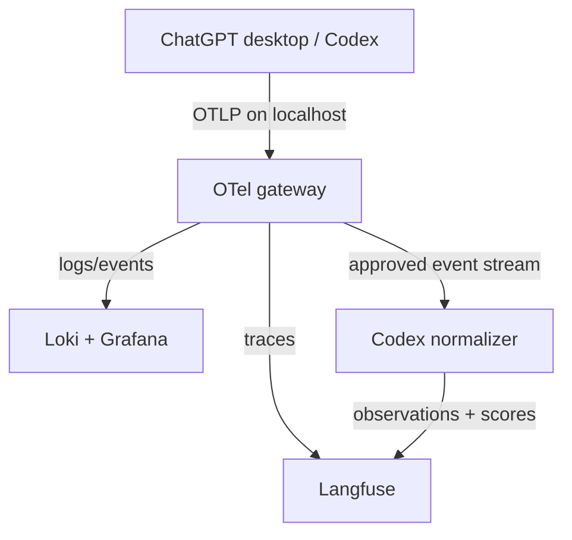

# Codex Desktop Langfuse Telemetry

Kubernetes-hosted observability stack for ChatGPT desktop / Codex Work Mode: OpenTelemetry gateway, Langfuse, Loki, Grafana, and a first-party redaction-aware normalizer/evaluator extension.

**Default profile:** `desktop-local` (Windows + Docker Desktop Kubernetes, loopback-only OTLP).  
**Alternate profile:** `shared-cluster` (separate values overlay — not a public expose of local settings).

Primary outcome: near-real-time visibility into Codex and subagent activity, token counts, model/effort, duration, errors, and tool activity—plus an opt-in path to prompt/output capture and scored agent traces—without exposing telemetry outside the workstation by default.

## Architecture



| Namespace | Contents |
| --- | --- |
| `agent-observability` | OTel gateway, Loki, Grafana, normalizer/evaluator |
| `langfuse` | Langfuse web/worker + chart-managed Postgres, ClickHouse, Redis |

## Repository layout

| Path | Purpose |
| --- | --- |
| `SPEC.md` / `docs/` | Full technical specification (source of truth) |
| `charts/codex-telemetry-extension/` | First-party Helm chart (normalizer + evaluator) |
| `values/desktop-local/` | Default workstation Helm values |
| `values/shared-cluster/` | Portable shared-cluster overlays |
| `services/` | Starter normalizer and evaluator application code |
| `scripts/` | Preflight, install, expose, and port-forward helpers |
| `runbooks/` | Content-capture disable/erase, PVC purge, capacity checks |
| `dashboards/codex-desktop/` | Grafana dashboard placeholders (build from live event samples) |
| `config/` | Example Codex desktop `config.toml` telemetry block |
| `network-policies/` | Restrictive NetworkPolicy manifests |

## Prerequisites

- Windows 11 with WSL 2 and Docker Desktop Kubernetes
- `kubectl`, Helm 3
- Kubernetes context `docker-desktop` (verify before every install)
- Docker Desktop budget baseline: ~8 vCPU / 16 GiB RAM when available

## Quick start (`desktop-local`)

```bash
# 0. Preflight
./scripts/preflight.sh

# 1. Add chart repositories
./scripts/add-helm-repos.sh

# 2. Create namespaces and install base + gateway releases
./scripts/install-desktop-local.sh

# 3. Expose OTLP to Windows loopback (preferred Docker Desktop route, else port-forward)
./scripts/expose-otel-gateway.sh

# 4. Port-forward UIs (Langfuse + Grafana)
./scripts/port-forward-uis.sh
```

Then configure ChatGPT desktop telemetry (user-scope `config.toml`) from `config/config.toml.example`. Keep `log_user_prompt = false` for the initial metadata-only deployment.

**Never** bind OTLP to `0.0.0.0`, publish a public Ingress, or expose 4317/4318 to the LAN.

## Feature gates

| Mode | Normalizer | Evaluator | Prompt content |
| --- | --- | --- | --- |
| Metadata-only (default) | Disabled / no content body | Disabled | `log_user_prompt = false` |
| Content-capture (opt-in) | Enabled with allowlist redaction | Optional, after calibration | Separate Langfuse project `codex-desktop-content` |

See [SPEC.md](SPEC.md) §6–§7 and [runbooks/content-capture-disable-erase.md](runbooks/content-capture-disable-erase.md).

## Chart versions

Pinned chart versions live in [`versions.yaml`](versions.yaml). Update the lock after `helm repo update` and record resolved versions before applying.

## Security defaults

- OTel gateway is the only host-facing service; bind to `127.0.0.1` only.
- No secrets in committed Helm values — use Kubernetes Secrets from local env or encrypted secret workflow.
- Secrets patterns are gitignored (see `.gitignore`).
- NetworkPolicies restrict egress from `otel-gateway` and `codex-normalizer`.

## Acceptance

Checklist: [docs/acceptance-criteria.md](docs/acceptance-criteria.md) (copied from SPEC §12).

## References

Full design, phases, risks, and external links: [SPEC.md](SPEC.md).
