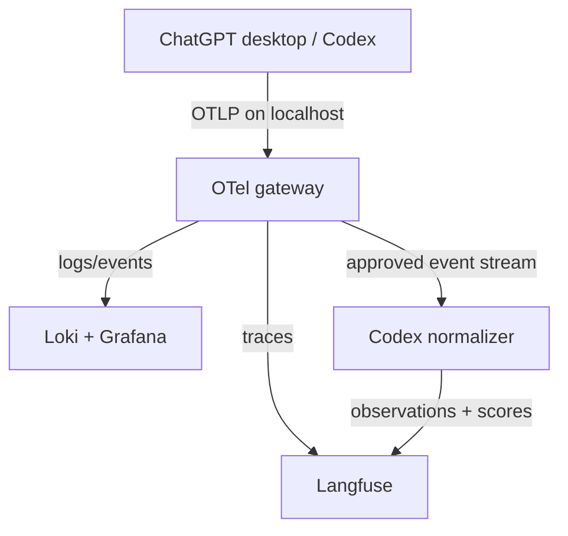

# Codex Desktop Telemetry Stack — Technical Specification

**Target:** Windows workstation running ChatGPT desktop Work Mode, Docker Desktop with WSL 2, local Kubernetes, and Helm; portable extension profile for a shared Kubernetes cluster  
**Status:** Proposed  
**Primary outcome:** Near-real-time visibility into Codex and subagent activity, response-completion token counts, model/effort, duration, errors, and tool activity—plus an opt-in path to prompt/output capture and scored agent traces—without exposing telemetry outside the workstation by default.

## 1. Decision summary

Deploy a Kubernetes-hosted observability stack behind a single OpenTelemetry (OTel) gateway. A custom normalization service turns only approved Codex events into Langfuse-native observations; an evaluation path attaches explicitly defined quality scores.



Use **Langfuse** for the searchable agent/trace experience and **Grafana + Loki** for exact Codex event fields, including the token counts emitted at `response.completed`. This is intentionally a two-backend design: Langfuse ingests OTLP traces, whereas Codex documents its detailed token-completion data as OTel events/logs. The normalizer is needed only for the richer DX-style view: normalized prompt/output records, explicit task/session correlation, and Langfuse scores.

Do not expect Langfuse alone to calculate authoritative ChatGPT credit usage or to always reconstruct a perfect root-agent/subagent tree. The desktop OTel contract does not promise system-prompt text, hidden reasoning, or a complete assistant-output field. The normalizer must be schema-driven and must never invent missing content or relationships.

The OTel gateway is the only service exposed to the Windows host. Its ports must bind to `127.0.0.1` only. Langfuse, Grafana, Loki, Postgres, Redis, and ClickHouse remain cluster-internal and are accessed through authenticated localhost port-forwards.

## 2. Scope and non-goals

### In scope

- A self-hosted Langfuse v3 release managed with Helm.
- A gateway-mode OTel Collector managed with Helm.
- Local Loki and Grafana releases for Codex OTel log inspection and dashboards.
- Windows-host access from the ChatGPT desktop app to the collector over loopback.
- A custom `codex-telemetry-extension` Helm chart with a redaction-aware normalizer and optional evaluator worker.
- Helm values, Kubernetes Secrets, persistence, resource guardrails, operational checks, and acceptance tests.
- A portable shared-cluster profile with explicit changes for storage, identity, ingress, and secrets.

### Explicit non-goals

- Capturing general ChatGPT conversations that do not use local Codex telemetry.
- Treating Langfuse cost estimates as the source of truth for ChatGPT plan credits.
- Publishing a public ingress, exposing an OTLP listener to the LAN, or using this local stack as a team/shared production service.
- Capturing prompt or tool-result content by default.
- Claiming that a quality rating is objective, free, or automatically available without an explicit evaluation rubric.

## 3. Design assumptions

| Area | Assumption / decision |
| --- | --- |
| Host | Windows 11 with WSL 2 and Docker Desktop Kubernetes enabled. |
| Kubernetes context | `docker-desktop`; verify before every install. |
| Exposure | Docker Desktop provides the host-side local-service route. Validate it on the actual cluster; use a managed `kubectl port-forward` fallback if local LoadBalancer exposure is unavailable. |
| Storage | Local dynamic storage only. Identify the installed default StorageClass before installing. This is a workstation environment, not HA storage. |
| Data classification | Prompts, tool output, source snippets, and command output may be sensitive. Default to metadata-only telemetry. |
| Authentication | No auth on the collector's loopback listener; its security boundary is loopback-only binding and Windows Firewall. Use Langfuse account/project credentials for UI/API access. |
| Retention | Start at 7 days for Loki and 14 days for Langfuse. Reassess after measuring disk growth. |
| Deployment profiles | `desktop-local` is the default. `shared-cluster` is a separate values overlay, not the same release configuration with a public endpoint added later. |
| Content capture | Default is metadata-only. Prompt capture and semantic evaluation require a separate, explicit `content-capture` feature gate. |

## 4. Component architecture

### 4.1 Kubernetes namespaces

| Namespace | Contents | Notes |
| --- | --- | --- |
| `agent-observability` | OTel gateway, Loki, Grafana, normalizer/evaluator, monitoring Secrets/ConfigMaps | One operational boundary for telemetry plumbing and custom adapters. |
| `langfuse` | Langfuse web/worker plus chart-managed Postgres, ClickHouse, and Redis | Keep Langfuse state isolated from monitoring plumbing. |

### 4.2 Helm releases

| Release | Chart | Mode | Purpose |
| --- | --- | --- |
| `otel-gateway` | `open-telemetry/opentelemetry-collector` | Deployment, 1 replica | Receives OTLP from the desktop app; routes traces, logs, and metrics. |
| `langfuse` | `langfuse/langfuse` | Default local chart profile | Trace UI, search, project management, and Langfuse data stores. |
| `loki` | `grafana/loki` | Single-binary, single replica | Stores Codex event/log stream, including response-completion token fields. |
| `grafana` | `grafana/grafana` | Single replica | Dashboards and Explore view for Loki; optionally link to Langfuse. |
| `codex-telemetry-extension` | First-party local chart in the deployment repository | Deployment, 1 replica each | Redacts and normalizes selected Codex events into Langfuse observations; optionally executes or schedules scoring. |

Use the official chart repositories and pin the resolved chart versions in the deployment repository's lock file. The Langfuse chart deploys Langfuse and its backing data stores by default; for a local workstation, accept that default rather than prematurely externalizing Postgres, ClickHouse, or Redis.

### 4.3 Collector signal routing

| Signal from Codex | Collector pipeline | Destination | Expected value |
| --- | --- | --- |
| Traces | `traces` | Langfuse OTLP/HTTP endpoint | Activity timeline and any trace hierarchy provided by Codex. |
| Logs/events | `logs` | Loki OTLP/HTTP endpoint | `codex.sse_event` records, including token counts at `response.completed`; request durations, tool decisions/results, and errors. |
| Approved content events | `logs` fan-out | Codex normalizer | Disabled until the content-capture gate is enabled; creates no semantic Langfuse record until the source schema is verified. |
| Metrics | `metrics` | Initially debug/Prometheus scrape only | Collector health and future derived metrics. Do not promise native per-turn cost metrics until an event sample is inspected. |

**Important:** Langfuse accepts OTLP/HTTP traces, not OTLP/gRPC. The desktop app may use gRPC to reach the local collector; the collector performs the protocol conversion for Langfuse. Loki also receives logs through its native OTLP/HTTP endpoint.

### 4.4 Deployment profiles and portability

| Concern | `desktop-local` profile | `shared-cluster` profile |
| --- | --- | --- |
| Desktop-to-collector route | Windows loopback only through Docker Desktop Kubernetes | Authenticated OTLP ingress/VPN/private network; never an anonymous public listener. |
| Storage | Docker Desktop local PVCs; disposable data | Cluster-approved StorageClass, backup policy, availability plan, and capacity monitoring. |
| Langfuse data stores | Chart-managed Postgres, ClickHouse, Redis | Approved managed services or a production-grade stateful deployment. |
| Secrets | Local encrypted secret workflow/Kubernetes Secrets | External secret manager and workload identity; no plaintext Helm values. |
| Access | `kubectl port-forward` to UIs | SSO/authenticated ingress plus RBAC. |
| Operations | Single workstation and bounded retention | GitOps/Helm release automation, upgrade policy, observability, and incident ownership. |

The Helm charts can run in any conformant Kubernetes environment, but this specification is **not** a drop-in child chart for arbitrary application repositories. Keep it as a platform add-on in its own repository or in a dedicated `platform/agent-observability/` directory. Application charts must not own Langfuse, Loki, or the telemetry gateway lifecycle.

## 5. Networking design

### 5.1 Required endpoint contract

| Caller | Endpoint | Protocol | Binding | Purpose |
| --- | --- | --- | --- | --- |
| ChatGPT desktop app | `127.0.0.1:4317` | OTLP/gRPC | Windows loopback | Codex trace/log/metric export to the OTel gateway. |
| ChatGPT desktop app (optional) | `127.0.0.1:4318` | OTLP/HTTP | Windows loopback | Fallback if the desktop client requires HTTP. |
| OTel gateway | `langfuse-web.langfuse.svc.cluster.local` | OTLP/HTTP | Cluster-internal | Sends traces to Langfuse `/api/public/otel`. |
| OTel gateway | `loki-gateway.agent-observability.svc.cluster.local` | OTLP/HTTP | Cluster-internal | Sends logs to Loki `/otlp`. |
| OTel gateway | `codex-normalizer.agent-observability.svc.cluster.local` | OTLP/HTTP logs | Cluster-internal | Delivers the gated, raw event stream for redaction and Langfuse normalization. |
| Codex normalizer | `langfuse-web.langfuse.svc.cluster.local` | Langfuse SDK/API | Cluster-internal | Creates normalized trace/observation/generation records and writes scores. |
| Browser | localhost port-forwards | HTTP | Windows loopback | Langfuse and Grafana UI only. |

### 5.2 Host access strategy

1. **Preferred:** expose only the OTel gateway receiver through Docker Desktop's local Kubernetes service mechanism and prove that `127.0.0.1:4317` and `:4318` are listening from Windows.
2. **Fallback:** run a supervised `kubectl port-forward` process from WSL for the OTel gateway service. It must be treated as part of the stack lifecycle, not as an ad hoc terminal command.
3. **Never:** use `--address 0.0.0.0`, a public Ingress, a router port-forward, or a LAN-reachable NodePort for OTLP.

Docker Desktop's current Kubernetes implementation and service behavior can vary by the selected cluster provisioner/version. The installation must include a preflight check proving Windows loopback reachability before the ChatGPT desktop app is pointed at the collector.

### 5.3 Network controls

- Apply NetworkPolicies that allow `otel-gateway` egress only to the Langfuse web Service, Loki gateway Service, `codex-normalizer`, DNS, and required Kubernetes APIs.
- Allow `codex-normalizer` egress only to Langfuse, DNS, and—only if an LLM-as-a-Judge evaluator is enabled—its explicitly approved model endpoint.
- Keep all dashboards/services as `ClusterIP`; use `kubectl port-forward` for UI access.
- Place no API keys in Helm values committed to Git. Use Kubernetes Secrets provisioned from local environment variables or encrypted secrets.
- Configure Windows Firewall to block inbound access to 4317 and 4318 from non-loopback addresses if Docker Desktop exposes the service more broadly than intended.

## 6. Codex desktop configuration contract

Open **ChatGPT desktop → Settings → Configuration → Open config.toml**. Add the telemetry configuration at user scope, not repo scope. The exact schema must be validated against the installed Codex version; use this as the required intent:

```toml
[otel]
environment = "desktop-local"
log_user_prompt = false

# Send logs/events to the local gateway.
exporter = { otlp-grpc = { endpoint = "http://127.0.0.1:4317" } }

# Send trace data to the same local gateway.
trace_exporter = { otlp-grpc = { endpoint = "http://127.0.0.1:4317" } }

# Optional on day one; retain only if a receiver sample confirms useful metrics.
metrics_exporter = { otlp-grpc = { endpoint = "http://127.0.0.1:4317" } }
```

### 6.1 Metadata-only mode — required starting point

- Leave `log_user_prompt = false`. Enable prompt content only after a conscious review of what may leave the desktop app and persist in local storage.
- Restart the desktop app after changing telemetry configuration.
- Tag the resource/environment as `desktop-local` and create a separate Langfuse project named `codex-desktop`; do not mix this with application-production traces.
- The collector must be running before a monitored run starts. Exporters batch asynchronously and may flush on process shutdown.

### 6.2 Content-capture mode — explicit opt-in

Content capture is a second deployment phase, not a default flag. It can record actual user prompt text in the Codex OTel log stream:

```toml
[otel]
log_user_prompt = true
```

Enabling this field does **not** mean the system has access to system prompts, hidden reasoning, or a guaranteed full assistant response. Codex documents user-prompt content as an opt-in event field; all other semantic content must be proven from a sanitized event sample before it is stored or evaluated.

Before enabling it:

1. Obtain approval for prompt retention and define the permitted purpose: personal debugging, quality evaluation, or regression research.
2. Enable the normalizer's allowlist/redaction policy first; it must drop unknown fields, secrets, credentials, access tokens, local paths when unwanted, and tool-output bodies by default.
3. Use a separate Langfuse project, `codex-desktop-content`, with a shorter retention period and its own credentials.
4. Run a non-sensitive canary prompt, inspect Loki and Langfuse, and prove that only intended fields were retained.
5. Provide a one-command disable/erase runbook for the content project and its PVCs.

## 7. Helm configuration requirements

### 7.1 OTel gateway values

Deploy the collector in `deployment` mode with one replica. Use the collector-contrib image, because it includes the processing/export components needed for this integration. Define the following components:

```yaml
mode: deployment
replicaCount: 1

config:
  receivers:
    otlp:
      protocols:
        grpc:
          endpoint: 0.0.0.0:4317
        http:
          endpoint: 0.0.0.0:4318

  processors:
    memory_limiter:
      check_interval: 5s
      limit_percentage: 75
      spike_limit_percentage: 25
    batch: {}

  exporters:
    otlphttp/langfuse:
      endpoint: ${env:LANGFUSE_OTLP_ENDPOINT}
      headers:
        Authorization: ${env:LANGFUSE_OTLP_AUTHORIZATION}
        x-langfuse-ingestion-version: "4"
    otlphttp/loki:
      endpoint: ${env:LOKI_OTLP_ENDPOINT}
    otlphttp/codex-normalizer:
      endpoint: ${env:CODEX_NORMALIZER_OTLP_ENDPOINT}

  service:
    pipelines:
      traces:
        receivers: [otlp]
        processors: [memory_limiter, batch]
        exporters: [otlphttp/langfuse]
      logs:
        receivers: [otlp]
        processors: [memory_limiter, batch]
        exporters: [otlphttp/loki, otlphttp/codex-normalizer]
      metrics:
        receivers: [otlp]
        processors: [memory_limiter, batch]
        exporters: [debug]
```

Implementation notes:

- The example is an interface contract, not a copy-paste release file. Confirm the collector chart's exact `extraEnvs`, `service`, and `ports` fields against the chart version before applying.
- Add a `debug` exporter only in development and route it to collector logs briefly; disable it once the pipeline is validated to avoid noise/feedback loops.
- Source the Langfuse authorization header from a Kubernetes Secret. It is Basic authentication containing the Langfuse project public and secret keys in base64 form.
- Use Langfuse's OTLP endpoint base (`.../api/public/otel`); the OTel HTTP exporter appends the signal-specific path.
- Route `otlphttp/codex-normalizer` only when the `content-capture` feature gate is enabled. In metadata-only mode the logs pipeline has only the Loki exporter.

### 7.2 Codex telemetry extension chart

`codex-telemetry-extension` is a small, first-party chart and service maintained with this deployment—not an off-the-shelf Langfuse plugin. It has two independently enabled workloads:

| Workload | Responsibility | Default | Must not do |
| --- | --- | --- | --- |
| `codex-normalizer` | Receives an OTLP log stream, validates a versioned event schema, redacts data, correlates events by conversation/agent ID, and writes Langfuse-native traces/observations/generations only when supported fields exist. | Disabled | Guess output text, synthesize parent-child relationships, or retain unknown fields. |
| `codex-evaluator` | Attaches named Langfuse scores to completed, normalized traces or observations. | Disabled | Evaluate a trace with missing required input/output, overwrite human scores, or send content to an unapproved external model. |

#### Normalizer contract

1. **Input:** the collector's OTLP log stream from a single, versioned Codex event adapter.
2. **Schema gate:** accept only event types and fields demonstrated in recorded canary samples. Preserve the original event ID, time, conversation ID, model, reasoning effort, and agent/thread ID where present.
3. **Redaction gate:** allowlist fields; redact common secret patterns before persistence; omit tool-result bodies and any unknown payload field unless specifically approved.
4. **Semantic mapping:** create a Langfuse trace for a known conversation; create a generation only if the event schema contains approved prompt and full output fields. If output is absent or partial, write a generic observation with `output_capture=unavailable` rather than a fabricated generation.
5. **Idempotency:** use a stable source-event key so collector retries cannot duplicate Langfuse observations or scores.
6. **Auditability:** record `normalizer_version`, source-event type, redaction policy version, and `content_capture` state on each generated Langfuse record.

#### Evaluation contract

Scores are explicit named objects, not a generic "good/bad" label. The initial score catalogue is:

| Score | Type | Producer | Required evidence |
| --- | --- | --- | --- |
| `task_completed` | boolean | Human review or deterministic evaluator | A user confirmation, test result, or declared acceptance criterion. |
| `execution_efficiency` | numeric 0–1 | Deterministic evaluator | Observed token count, duration, tool retries, and subagent count against a task-class baseline. |
| `response_quality` | numeric 1–5 | Human annotation or LLM-as-a-Judge | Approved user prompt, complete output, and a written rubric. |
| `prompt_clarity` | numeric 1–5 | Human annotation or LLM-as-a-Judge | Approved user prompt and a rubric for scope, constraints, and testable definition of done. |
| `safety_or_privacy_violation` | boolean | Deterministic rule or human review | Redaction/secret-scan result or review evidence. |

An LLM-as-a-Judge evaluator is optional. It requires a model connection, a stable rubric, and the approved prompt/output content. It adds model cost and may send that content outside the workstation if the judge uses a hosted model. Prefer manual annotations and deterministic scores first; enable an LLM judge only after calibrating it against a small human-reviewed set.

### 7.3 Langfuse values

Start from the official chart defaults, then set:

- `persistence.enabled: true` for Postgres, ClickHouse, and Redis.
- Explicit small local PVC sizes, documented in the deployment repository (initially 10–20 GiB for ClickHouse; 5 GiB each for Postgres and Redis, subject to workstation capacity).
- A strong, locally managed `NEXTAUTH_SECRET` / encryption secret and non-default database passwords in Kubernetes Secrets.
- The service as `ClusterIP`; no Ingress.
- A resource ceiling so an accidental trace burst cannot starve Docker Desktop or the Windows host.

Create one Langfuse organization and one `codex-desktop` project for metadata-only tracing after deployment. If content capture is enabled, create a separate `codex-desktop-content` project with distinct credentials, access policy, and shorter retention. Generate project keys and place the Basic-auth value only in the Secrets of the component that needs them.

### 7.4 Loki and Grafana values

- Use a single-binary Loki deployment with local persistence and a 7-day retention policy.
- Enable Loki OTLP ingestion and `allow_structured_metadata`; the OTLP path stores high-cardinality event fields as structured metadata rather than unbounded index labels.
- Provision the Loki data source into Grafana.
- Provision a dashboard folder called **Codex Desktop**.
- Create a Grafana local admin credential via Kubernetes Secret; use a port-forward for UI access.

## 8. Dashboard and query requirements

The first dashboard must be based on actual received event attributes, not guessed field paths. Capture a sanitized `codex.sse_event` sample, then map its fields into Grafana panels.

Required panels:

| Panel | Signal | Acceptance condition |
| --- | --- | --- |
| Active runs | trace/log start and completion events | Shows root and worker conversation IDs, model, reasoning effort, and elapsed duration. |
| Completed turns | `codex.sse_event` with `response.completed` | Shows completion timestamp, agent/conversation ID, model, and token counts present in the event. |
| Token trend | completion token values | Aggregates input/output/total token fields by 5-minute window only after field validation. |
| Subagent activity | conversation/parent relationship when supplied | Shows worker count and completion status; labels absent relationships as unknown rather than inferring hierarchy. |
| Errors and retries | `codex.api_request` / error fields | Shows request failure count, status, and duration. |
| Tool activity | `codex.tool_decision` / `codex.tool_result` | Shows approvals/denials and long-running tools. |
| Content-capture coverage | normalizer audit fields | Shows how many completed traces have approved prompt content, complete output, partial output, or no output. Never treats a partial record as a generation. |
| Score coverage | Langfuse score objects | Shows each score's count, producer, rubric version, and proportion of eligible traces scored. |
| Quality trend | approved Langfuse scores | Shows score distribution by model, reasoning effort, task class, and time only after enough calibrated samples exist. |

Langfuse is the primary UI for trace browsing and score analysis. Grafana is the primary UI for raw Codex completion telemetry. The two link by time, model, and conversation ID where that field is available.

## 9. Data, privacy, and retention controls

1. Default telemetry must not include prompt content. `log_user_prompt = false` is mandatory for the initial deployment.
2. Content capture requires a separate feature gate, Langfuse project, Secret set, redaction-policy version, and a non-sensitive canary test. An event schema change automatically disables semantic mapping until it is reapproved.
3. Treat tool output, error payloads, source snippets, local paths, and command output as potentially sensitive. The normalizer must use an allowlist and remove unknown fields before persistence.
4. Store data only on the local Docker Desktop disk in the `desktop-local` profile. Do not send to Langfuse Cloud, Grafana Cloud, or another SaaS backend in this phase.
5. A hosted LLM-as-a-Judge evaluator is a deliberate external-data transfer. It is off by default and requires a documented model endpoint, data classification approval, retention terms, per-run budget, and a kill switch.
6. Back up neither secrets nor traces automatically in phase one. If the workstation is lost, the telemetry data is disposable.
7. Before enabling prompt logging, document the purpose, retention period, and exact users who can access the content project and Grafana.

## 10. Resource and lifecycle plan

### Workstation budget

Allocate Docker Desktop a working ceiling of **8 vCPU and 16 GiB RAM** if the host has capacity. This is a planning baseline, not a hard requirement; Langfuse's ClickHouse dependency is the largest consumer. Reserve an additional 0.5 vCPU / 512 MiB memory limit for the normalizer and keep the evaluator at zero replicas until content capture is proven. If the workstation cannot sustain this budget, use Langfuse Cloud plus an in-cluster OTel collector, or run the stack only when actively debugging agent behavior.

### Start/stop behavior

- Docker Desktop start → Kubernetes becomes Ready → Helm releases reconcile → OTel gateway health endpoint becomes reachable → start ChatGPT desktop monitoring.
- Before Docker Desktop shutdown, close/finish active Codex work where possible to allow asynchronous telemetry exporters to flush.
- Use Helm release history for upgrades/rollbacks. Do not delete PVCs during normal release upgrades.

## 11. Implementation phases

### Phase 0 — Preflight

1. Confirm WSL 2 integration, Docker Desktop Kubernetes, `kubectl`, and Helm.
2. Confirm `kubectl config current-context` is `docker-desktop`.
3. Record the default StorageClass and free disk/RAM available to Docker Desktop.
4. Create a private deployment repository with `charts/`, `values/`, `scripts/`, and `runbooks/`; add secret files to `.gitignore`.
5. Select the deployment profile: `desktop-local` or `shared-cluster`. Do not begin from local values and merely expose them publicly.

### Phase 1 — Base stateful services

1. Create `langfuse` and `agent-observability` namespaces.
2. Add and update the Langfuse, OpenTelemetry, and Grafana Helm repositories.
3. Install Langfuse with persistent storage and wait for web/worker/database readiness.
4. Install Loki and Grafana with persistent storage; provision the Loki data source.
5. Smoke-test the two UIs through loopback port-forwards.

### Phase 2 — Telemetry routing

1. Create the OTel gateway Secret with Langfuse project credentials and internal endpoint settings.
2. Install the OTel gateway release with trace and log pipelines.
3. Expose only 4317 and 4318 to Windows loopback; validate from Windows with a TCP check before configuring Codex.
4. Apply the desktop `config.toml` telemetry configuration and restart the app.
5. Run one small, non-sensitive task with exactly one explicit subagent.

### Phase 3 — Validation and dashboarding

1. Confirm one trace arrives in Langfuse.
2. Confirm `codex.sse_event` completion records arrive in Loki.
3. Inspect the received schema and record actual field names for token counts, model, conversation ID, and parent IDs.
4. Build the initial Grafana dashboard from those observed fields.
5. Run an Ultra task with two explicit subagents and verify the dashboard distinguishes the worker activity without fabricating relationships.

### Phase 4 — Content capture and normalization

1. Keep the evaluator disabled. Deploy the normalizer with a deny-by-default field allowlist and its audit events only.
2. Use a non-sensitive canary task to record a sample with `log_user_prompt = true` in a short-lived content project.
3. Confirm the exact user-prompt field is captured; determine whether a complete assistant-output field is actually exported. Do not enable generation mapping if it is absent or partial.
4. Enable semantic mapping only for verified fields. Confirm content is redacted in both Loki and Langfuse as designed.
5. Run idempotency and retry tests; one source event must create no more than one normalized observation/score.

### Phase 5 — Quality evaluation

1. Create the score configs in the evaluation contract and publish rubric version `v1` for each non-deterministic score.
2. Collect a small human-reviewed calibration set before enabling any LLM-as-a-Judge workflow.
3. Implement deterministic scores first: task completion evidence, retries, duration, and token-efficiency baseline.
4. If approved, enable an LLM judge for eligible complete traces only, with a per-run budget and external-model egress control.
5. Compare judge scores with human annotations; retain or disable the judge based on documented agreement criteria.

### Phase 6 — Hardening

1. Enforce restrictive NetworkPolicies and confirm no LAN listener exists.
2. Add resource limits/requests and retention enforcement.
3. Add a weekly PVC-growth check and a safe, documented purge/runbook.
4. Decide whether prompt logging and/or an LLM judge remain justified; keep both disabled unless a specific evidence-backed use case requires them.

## 12. Acceptance criteria

The deployment is complete only when all conditions below are true:

- [ ] `helm list -A` shows healthy releases for `langfuse`, `otel-gateway`, `loki`, `grafana`, and the disabled-by-default `codex-telemetry-extension` release.
- [ ] All stateful components have bound PVCs and survive a Docker Desktop restart.
- [ ] `127.0.0.1:4317` is reachable from Windows, while the port is not reachable from another LAN device.
- [ ] A desktop Codex task produces an OTel trace visible in Langfuse within one minute of completion.
- [ ] The same task produces a Loki completion event that includes the documented token-count payload when present.
- [ ] Grafana can show the task's model, duration, and observed token fields without scraping or parsing ChatGPT UI data.
- [ ] A two-subagent run produces distinct worker activity records or explicitly documented limitations if Codex does not export the parent-child relationship.
- [ ] `log_user_prompt` remains `false` and no prompt content appears in a sample query.
- [ ] Langfuse, Grafana, and OTLP endpoints are inaccessible from the LAN and require localhost access paths only.
- [ ] In metadata-only mode, the normalizer/evaluator receives no prompt or output body.
- [ ] In content-capture mode, a non-sensitive canary proves that only approved prompt/output fields are retained and that unknown fields/tool-output bodies are redacted or dropped.
- [ ] A trace without a verified complete output cannot receive `response_quality` or `prompt_clarity` from an automated evaluator.
- [ ] A retried source event does not create duplicate Langfuse observations or scores.
- [ ] Each score records its type, producer, rubric/policy version, and evidence source.

## 13. Risks and mitigations

| Risk | Effect | Mitigation |
| --- | --- | --- |
| Desktop Work Mode telemetry rollout differs from local Codex CLI | No data or partial data | Validate with one tiny task before investing in dashboards; treat exporter configuration as version-specific. |
| Codex emits token counts as logs rather than GenAI trace attributes | Langfuse has incomplete usage/cost view | Use Loki/Grafana as the authoritative raw-event view. |
| Docker Desktop service exposure changes across Kubernetes provisioners | Desktop cannot reach OTLP gateway | Preflight loopback test; use supervised `kubectl port-forward` fallback. |
| Local stateful workload exhausts laptop RAM/disk | Docker Desktop becomes unstable | Resource limits, low retention, bounded PVCs, and a weekly capacity check. |
| Prompt/tool data is sensitive | Local data exposure | Metadata-only default, loopback-only networking, no cloud exporter, secret management, short retention. |
| Prompt content is enabled without an approved output field | Misleading or incomplete quality scores | Separate feature gate; normalizer creates generic observations only and blocks generation/evaluator eligibility. |
| LLM judge has weak or drifting judgments | False confidence in quality trends | Versioned rubric, human calibration set, agreement threshold, score coverage dashboard, and a kill switch. |
| Hosted judge exports local prompt/output data | Privacy/compliance breach | Default off; explicit endpoint approval, minimization/redaction, budget cap, and egress NetworkPolicy. |
| Shared-cluster deployment reuses desktop-local networking or storage assumptions | Insecure/exposed service or data loss | Separate shared-cluster overlay and platform ownership; do not deploy local values unchanged. |
| Proactive Ultra delegation varies by task/model | Uneven event volume/shape | Dashboard observes, rather than assumes, subagent topology. |

## 14. Reference implementation sources

- [OpenAI Codex observability and telemetry](https://learn.chatgpt.com/docs/config-file/config-advanced#observability-and-telemetry) — OTel export, event categories, and `response.completed` token counts.
- [OpenAI Codex subagents](https://learn.chatgpt.com/docs/agent-configuration/subagents) — multi-agent behavior and token implications.
- [Langfuse Kubernetes Helm deployment](https://langfuse.com/self-hosting/deployment/kubernetes-helm) — chart repository, chart-managed dependencies, and local smoke test.
- [Langfuse OpenTelemetry ingestion](https://langfuse.com/integrations/native/opentelemetry) — OTLP/HTTP endpoint, Basic auth, and trace ingestion semantics.
- [Langfuse scores](https://langfuse.com/docs/evaluation/scores/overview) — human, code, API, and automated evaluation methods.
- [Langfuse LLM-as-a-Judge](https://langfuse.com/docs/evaluation/evaluation-methods/llm-as-a-judge) — rubric-based evaluation requirements and score behavior.
- [OpenTelemetry Collector Helm chart](https://opentelemetry.io/docs/platforms/kubernetes/helm/collector/) — deployment-mode collector and OTLP receivers/pipelines.
- [Grafana Loki OTel ingestion](https://grafana.com/docs/loki/latest/send-data/otel/) — use the `otlphttp` exporter and enable structured metadata.
